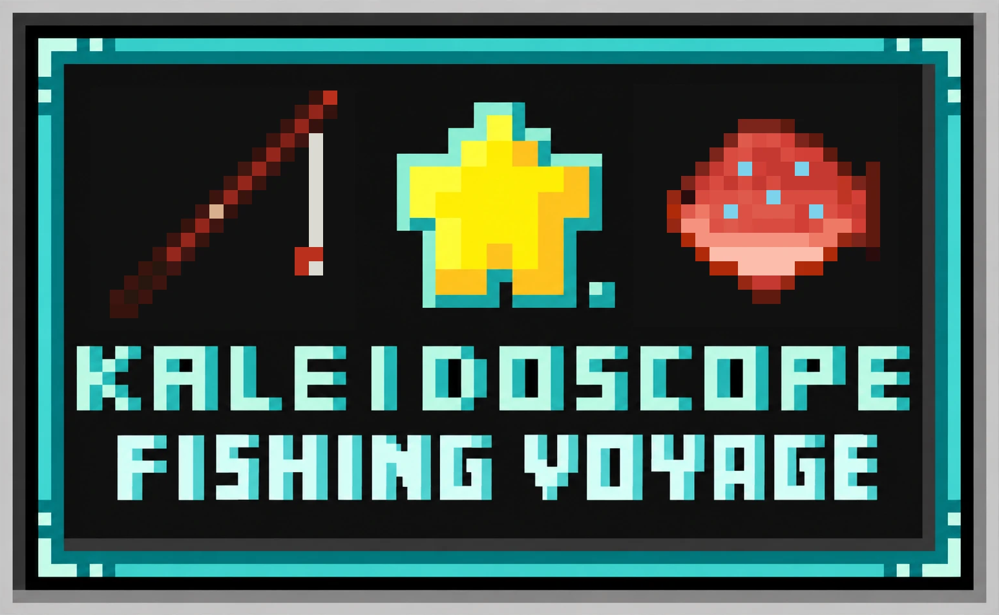

<p align="center">
  
</p>

# 森羅物語：漁歌 / Kaleidoscope Cookery: Fishing Voyage

森羅物語：廚房（基岩版移植）的非官方釣魚與海鮮附屬包。
An unofficial fishing and seafood add-on for the Bedrock Edition port of Kaleidoscope Cookery.

**目前版本 / Latest：1.4.0** · [下載 / Download](../../releases/latest) · [更新公告 / Release notes](RELEASE_NOTES_v1.4.0.md)

> **需要 / Requires:** 森羅物語：廚房（Kaleidoscope Cookery，基岩版移植，作者 Loyallay）1.6.1 以上。
> 本附屬包不修改森羅物語的任何檔案，只透過它公開的 Script Event API 註冊配方和手帳頁面。

## 內容

- **釣魚**：大魚上鉤時的收線小遊戲，竹、漁歌、熔岩、末影四種釣竿，可自由搭配鉤、線、浮標和餌。雷雨魚群、月相魚汛與潮汐都會影響漁況。
- **漁獲**：52 種，分布在 15 種水域：淡水、海水、紅樹林、河口、洞穴、冰下、下界、末地。另有四條傳說魚：河伯鯰、藍鰭皇鮪、冰湖主、熔岩龍鯉。
- **加工**：曬魚架（風乾魚、鹹魚、魷魚乾、柴魚、烏魚子、飛魚一夜干）、魚露甕（魚露、蝦醬）、魚案板（41 種魚，每一刀外觀都會變）。
- **料理與宴席**：湯、粥、飯、麵、清蒸、煎烤、炸物、壽司，共 84 道配方，都登錄在森羅廚房的鍋具與圖鑑；另有鮪魚大體、生魚片船、龍鯉石板燒等 16 種可放置的宴席。
- **裝飾**：魚缸、漁燈、錨、漁獲木箱、玻璃浮球、漁網牆飾、魚乾串、魚拓等；海岸與河岸會自然生成碼頭。
- **生物**：鸕鶿（可馴服，會潛水幫你抓魚）、鷺鷥、海鷗、漁販（每天加倍收購兩種魚）。
- **漁歌手帳**：依水域分頁的圖鑑、食譜與潮汐。
- **光影**：支援 Vibrant Visuals / RTX 材質。
- **給其他附屬包的 API**：`kaleidoscope_fishing:register_bait`、`kaleidoscope_fishing:register_catch`，可以註冊新的餌和漁獲。

## Features

- **Fishing**: a reeling minigame for big catches; four rods (bamboo, voyage, lava, ender) with interchangeable hooks, lines, bobbers and baits. Storm schools, moon-phase runs and tides change what bites.
- **Catches**: 52 species across 15 waters (freshwater, sea, mangrove, estuary, cave, under ice, Nether, End), plus four legendary fish.
- **Processing**: drying rack (dried and salted fish, dried squid, katsuobushi, karasumi, dried flying fish), fish sauce jar (fish sauce, shrimp paste), and the fish cleaning board (41 fish, each cut shown on the board).
- **Dishes and feasts**: 84 recipes registered with Cookery's stations and guidebook, and 16 placeable feasts.
- **Decor**: fish tanks, lanterns, anchor, catch crate, glass floats, net walls, fish prints and more; piers generate on coasts and river banks.
- **Mobs**: cormorant (tameable, dives and fishes for you), heron, seagull and the fish merchant (pays double for two fish each day).
- **Angler's journal**: catch log by water, recipes and tides.
- **Shaders**: Vibrant Visuals / RTX materials.
- **Add-on API**: other add-ons can register baits and catches through script events.

## 安裝 / Installation

1. 先安裝森羅物語：廚房 1.6.1 以上。 / Install Kaleidoscope Cookery 1.6.1 or newer first.
2. 從 [Releases](../../releases/latest) 下載 `.mcaddon`，點兩下匯入 Minecraft。 / Download the `.mcaddon` from [Releases](../../releases/latest) and open it.
3. 在世界設定中同時啟用森羅物語與漁歌的行為包、資源包。 / Enable both add-ons' behaviour and resource packs in the world settings.
4. 從舊版升級：先刪掉舊的漁歌再匯入新版，並先備份世界。 / Upgrading: remove the old Fishing Voyage first, and back up your world.

不想玩收線小遊戲，可以輸入 `/scriptevent kaleidoscope_fishing:minigame off`。
To turn the reeling minigame off: `/scriptevent kaleidoscope_fishing:minigame off`.

## 給其他附屬包 / For add-on authors

其他附屬包可以用 Script Event 註冊自己的餌和漁獲。 / Other add-ons can register their own baits and catches through script events.

| 事件 / Event | 方向 / Direction | 用途 / Purpose |
|---|---|---|
| `kaleidoscope_fishing:api_ready` | 漁歌 → 你 | 載入後送出，回報版本與能力 / sent after load, with version and capabilities |
| `kaleidoscope_fishing:api_ping` | 你 → 漁歌 | 請漁歌再送一次 `api_ready` / asks for `api_ready` again |
| `kaleidoscope_fishing:register_bait` | 你 → 漁歌 | `{"api":1,"source":"<ns>","baits":[{"id":"<item>","biteFactor":0.7}]}` |
| `kaleidoscope_fishing:register_catch` | 你 → 漁歌 | `{"api":1,"source":"<ns>","catches":[{"id":"<item>","w":6,"waters":["river"],"size":[20,60]}]}` |

- 只能註冊自己命名空間的物品；每次載入世界，收到 `api_ready` 之後要重新註冊。 / Register only items of your own namespace, again on every world load after `api_ready`.
- 完整的介面文件：[`docs/API.md`](docs/API.md)（含 1.5.0 開發中的事件廣播、查詢與漁販價格註冊）。 / Full reference: [`docs/API.md`](docs/API.md), including what 1.5.0 adds.
- 1.5.0 的企劃書：[`docs/PLAN_1.5.0.md`](docs/PLAN_1.5.0.md)。 / The plan for 1.5.0.
- 帶 `kaleidoscope_cookery:kitchen_knife` 標籤的刀都能在魚案板使用。 / Any knife tagged `kaleidoscope_cookery:kitchen_knife` works on the fish cleaning board.

## 從原始碼打包 / Building from source

需要 Python 3 與 Pillow；跑腳本測試另外需要 Node.js 22.15 以上。
Requires Python 3 and Pillow; the script tests also need Node.js 22.15+.

```
python tools/build.py pack    # 產生 ../Kaleidoscope_Fishing_Voyage_v<版本>.mcaddon
python tools/run_tests.py     # 跑全部離線測試
```

- 遊戲資料表在 `tools/data/*.json`，改完用 `python tools/build.py build` 重新產生 `scripts/data/generated.js`。
- 同一份原始碼打包出來的 `.mcaddon` 每次都完全相同。

### 測試 / Tests

`python tools/run_tests.py` 依序執行下面八項，全部通過才會回傳 0：

| 項目 | 檢查內容 |
|---|---|
| `build.py check` | `generated.js` 和 `tools/data` 一致 |
| `validate.py` | 交叉檢查所有 ID 引用。目前固定有 31 項「問題」是誤報（配方和地物規則的 ID 不是物品 ID、森羅物語自己的 ID），列在 `tools/tests/validate_baseline.txt`；只有出現新的項目才算失敗 |
| `check_models.py` | 3D 模型結構。有 10 個模型借用森羅物語的幾何，要把 `Kaleidoscope-Cookery-*.mcaddon` 放在本資料夾的上一層才會一起驗證，否則會註明「未驗證」 |
| `tests/test_pack.py` | JSON、manifest、物品 icon、光影材質、創造模式選單、方塊放置設定、生怪蛋、世界結構 |
| `tests/test_scripts.mjs` | 用模擬的遊戲環境載入全部腳本，測試自訂元件註冊、給其他附屬包的 API、傳說魚條件、1.4 新魚種 |
| `tests/test_play.mjs`、`test_play_fishing.mjs`、`test_play_world.mjs` | 在有狀態的模擬世界（`tools/tests/sim`）裡重播玩家操作：工作站、從拋竿到上鉤的釣魚流程、宴席、魚缸、魚販、海鷗、鸕鶿、挖蛤、圖鑑、森羅物語連動 |

這些測試只能證明檔案和程式邏輯沒問題，不能取代進遊戲實際遊玩。
These tests only prove that the files and the script logic hang together; they do not replace play-testing.

### icon 工具 / Icon tools

`tools/ai2pixel.py`、`tools/touchup_*.py`、`tools/review_sheet.py` 是製作物品 icon 用的工具，只在作者的工作環境能直接使用：

- 它們讀寫本倉庫上一層的 `icon_ai_input/`、`icon_preview/` 資料夾（不在倉庫裡）。
- 對照圖使用 Windows 的微軟正黑體（`C:\Windows\Fonts\msjh.ttc`）。

打包和測試都不需要這些工具。

## 授權 / License

- 美術素材（貼圖、模型、音效、文字）：[CC BY-NC-SA 4.0](https://creativecommons.org/licenses/by-nc-sa/4.0/)
- 腳本（`scripts/`）：BSD 3-Clause

詳見 `LICENSE.txt` 與 `CREDITS.txt`。

本專案與 Kaleidoscope Official Production Team、Loyallay、Mojang Studios、Microsoft 無關，也未獲其背書。
Not affiliated with or endorsed by the Kaleidoscope Official Production Team, Loyallay, Mojang Studios or Microsoft.
